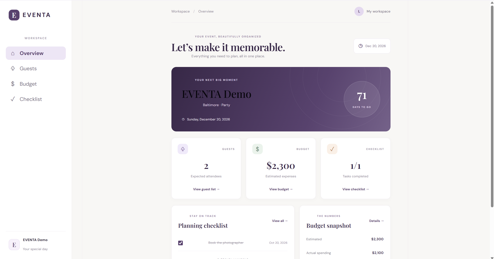

EVENTA — Event Planning Application

EVENTA is a full-stack event-planning application designed to help users organize events in one place. It combines event details, guest management, RSVP tracking, budget planning, and task management in a single web interface.

## Application Preview

Inspiration

EVENTA was inspired by my experience planning my own wedding. I wanted a way to keep event details, guest lists, RSVPs, budgets, and planning tasks organized in one place instead of managing everything separately. That personal experience motivated me to build a full-stack application that makes event planning more organized, intuitive, and manageable.

What started as a solution to a real-life need became an opportunity to strengthen my skills in React, Java, Spring Boot, REST APIs, and PostgreSQL while building a practical application with a polished user experience.

Features

Event Dashboard

View event details, including the name, date, location, and type.

See a countdown to the event date.

Review guest, budget, and task summaries.

Guest Management

Add guests with their names, RSVP statuses, party sizes, and notes.

Update RSVP statuses between Pending, Confirmed, and Declined.

Automatically calculate expected attendance, excluding declined guests.

Budget Tracking

Create budget items with categories, estimated costs, and actual costs.

Update actual spending for individual budget items.

Automatically recalculate total estimates, actual spending, and remaining budget.

Planning Checklist

Create tasks with descriptions and due dates.

Mark tasks as complete or incomplete.

Edit existing task details and deadlines.

Delete tasks when plans change.

Save changes through the backend so they persist after refreshing the page.

Technology Stack

Frontend

React

JavaScript

Vite

CSS

Backend

Java

Spring Boot

Maven

REST API

Database

PostgreSQL

Project Structure

event-planner/
├── backend/
│   └── src/
│       ├── main/
│       └── test/
├── frontend/
│   ├── public/
│   └── src/
│       ├── App.jsx
│       ├── App.css
│       └── main.jsx
└── README.md

Getting Started

Prerequisites

Install the following before running the application:

Java 17 or a compatible version required by the backend configuration

Node.js and npm

PostgreSQL

1. Configure the database

Create or configure a PostgreSQL database for EVENTA. Set the database connection properties in the backend's existing configuration file, typically:

backend/src/main/resources/application.properties

Use your local database name, username, and password. Keep credentials private and do not commit secrets to GitHub.

2. Start the backend

Open a terminal and run:

cd backend
.\mvnw.cmd test
.\mvnw.cmd spring-boot:run

The Spring Boot server runs on port 8080 with the current development configuration.

3. Start the frontend

Open a second terminal and run:

cd frontend
npm install
npm run dev

Open the local URL displayed by Vite, typically:

http://localhost:5173/

The frontend uses Vite's development proxy to forward /api requests to the backend.

Testing

Run the backend test suite with:

cd backend
.\mvnw.cmd test

Build the frontend for production with:

cd frontend
npm run build

Project Goals

EVENTA is a portfolio project focused on full-stack application development, REST API integration, database persistence, interactive user interfaces, and practical event-planning workflows.